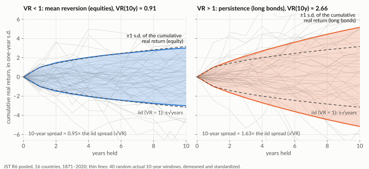
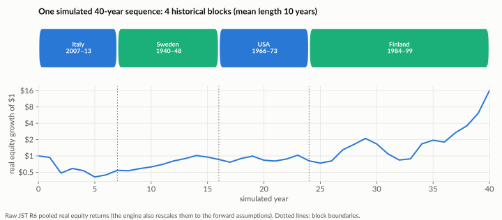
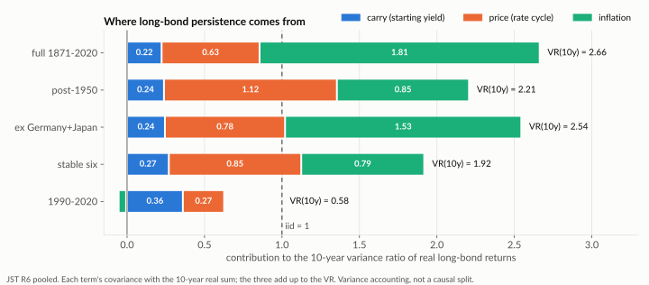

# Lifetime Allocation Optimizer — Methodology

Research note for the Lifetime Allocation Optimizer (`/glide-path`). The question: **what equity weight should a household hold at each age, before and after retirement?**

It assumes you know personal-finance basics (asset allocation, safe withdrawal rates, real versus nominal returns), not the statistics behind the tool. Terms are defined in [Key terms](#key-terms). The [`retirement` SWR methodology](../retirement/swr-methodology.md) is a companion note with the same return assumptions and historical data.

**How the answer is found.** A Monte Carlo optimizer tries equity weights age by age and keeps those that maximize the expected utility of retirement consumption. No rule of thumb such as "100 minus your age" is assumed. Results are reported under two return models:

- **iid**: each year's return is an independent draw from forward-looking assumptions (the app's default);
- **forward-block**: the same forward-looking averages, but with the year-to-year patterns of real historical sequences (the app's "Historical sequences" toggle).

## Contents

- [Summary](#summary)
- [Applying this](#applying-this)
- [Key terms](#key-terms)
- [1. Model](#1-model)
- [2. Results under iid returns](#2-results-under-iid-returns-the-default)
- [3. Results under historical sequencing](#3-results-under-historical-sequencing-forward-block)
- [4. The bond menu](#4-the-bond-menu)
- [5. Comparison with ACO and ERN](#5-comparison-with-aco-and-ern)
- [6. Caveats](#6-caveats)
- [7. Code and reproduction](#7-code-and-reproduction)
- [References](#references)

---

## Summary

Default household: age 35, $200k saved, $20k/yr contributions for 30 years, a $60k real retirement target of which $20k is guaranteed income (CPP/OAS/DB), a 30-year retirement, risk aversion γ = 4 and time preference β = 0.985.

1. **The return model decides whether there is a bond tent**, that is, equity dipping around retirement and rising again afterwards. Under iid, constant-dollar spending gives a tent bottoming at 30–70% equity, and the best constant weight is **70%** for a 30-year retirement (90–100% for 40–50 years; §2b). Under forward-block the optimum is **flat ~100% equity** (§3a).
2. **Flexible spenders hold 100% equity** throughout, in both models (§2b, §3a).
3. **The glide's shape is worth little; its level matters more.** Out of sample, the optimized glide beats the best constant weight by ≤ ~0.5% of certainty-equivalent (CE) income under iid, and by ≈ $0 under forward-block (§2e, §3a).
4. **The iid tent comes from over-funding.** The default plan's first-year withdrawal is only ~2.3% of its median retirement balance, so the optimizer has little use for upside and protects the floor. At a ~3.3% draw the tent disappears (§2f).
5. **Flat 100% is a verdict on long nominal bonds, not on equity.** In history they had bad decades, a 0.29 correlation with stocks and a fat left tail. Swap them for an idealized real asset and the optimum falls to ~50%; with realistic assumptions about a real fund, to 55–70% (§4a, §4c). In 1990–2020, ordinary nominal bonds already give 50% (§3c).
6. **A mostly real bond sleeve holds up in every regime tested.** In the full history CE rises with the real share of the bond sleeve all the way to 100%; in 1990–2020 the mix barely matters. Pair ~60% equity with an all-real sleeve, or ~80% with a half-real one. A US-CPI fund (XSTH) hedges ~90% of Canadian inflation in the eras where inflation matters (§4f).
7. **Guessing the regime wrong costs little.** Any constant weight from 70% to 100% costs at most ~2% of CE in any era tested (§3d).
8. **γ barely matters with constant-dollar spending.** Consumption is then almost always the full target or the guaranteed floor, so every γ ranks allocations the same way (§2d).

The app recommends what the selected model's simulation produces: the optimized glide, or the best constant weight unless the glide is clearly better (§1.5).

---

## Applying this

- **Choose the return model before the shape.** The two models can disagree on the equity level by 30pp, while the shape within either is worth ≤ ~0.5% of CE (§2e, §3a). Run both (`--compare-modes` in the CLI, or the app's Simulation toggle).
- **When the models disagree, pick a constant weight between their answers.** Any constant weight from 70% to 100% costs at most ~2% of CE in any era tested (§3d), so you do not need to know which regime is coming.
- **Leverage earns little.** In a young-saver case (age 30, $100k saved, $20k/yr for 30 years, $70k target), allowing up to 150% equity raised CE by under 1% ($250–450/yr) in both models, and the optimizer used it only in the first decade. That is inside the model's own uncertainty and ignores margin calls, rate changes and behaviour. Treat equity above ~110% as unrewarded.
- **An over-funded plan has no best allocation.** When every constant weight already delivers the target (both engines flag this), the allocation does not change income and the reported weight is the middle of a tie. Decide what the surplus is for: leave it (a bequest weight, Python `--bequest-weight` only) or use it (retire earlier or spend more).
- **Bequest weight (Python only; the web app fixes θ = 0).** θ = 0.25 / 0.5 on u(money left + one year of target spending) (§1.4). With γ = 4 a large estate adds little utility, so θ barely moves a plan that needs its money; in an over-funded plan it replaces the tie with a real choice (55–70% equity instead of a ~50% tie midpoint in our test).
- **Guaranteed-income start age.** A start age after retirement models a bridge: the portfolio funds the whole target until CPP/OAS/DB begins (§1.1). Retiring at 60 with $20k from 65 cost about 6% of CE ($52.5k → $49.3k) against the same income from 60.
- **The app's bonds are nominal.** Its bond asset is the forward curve's bond (iid) or JST long government bonds (forward-block). The real-bond results in §4 are research, not an app option; if your sleeve is mostly real return bonds or XSTH, §4f's lower equity weights apply instead.

---

## Key terms

**Returns and simulation**

| Term | Meaning here |
| --- | --- |
| **Real return** | Return after inflation. All amounts in this note are real (today's) dollars. |
| **Geometric vs arithmetic return** | Geometric is the rate a balance actually compounds at; arithmetic is the simple average of yearly returns, higher by roughly σ²/2 for a volatile asset. Planning assumptions are quoted geometric; a Monte Carlo draws from the arithmetic mean (§1.3). |
| **Monte Carlo** | Simulating thousands of possible market paths and averaging the outcomes. |
| **iid** | Independent and identically distributed: each year's return is a fresh draw, unrelated to earlier years. |
| **Sequencing** | The order in which good and bad years arrive, such as crashes followed by recoveries, or inflation decades. iid removes it. _Sequence-of-returns risk_ is a retiree's exposure to it: an early crash does more damage than a later one. |
| **Block bootstrap** | Simulating from history while keeping sequencing: paths are stitched from runs (blocks) of consecutive historical years. The _stationary_ version uses random block lengths with a set mean (here 10 years). |
| **Affine rescaling** | Shifting and stretching a historical return series to a target mean and volatility (`a + b·r`). It keeps the series' sequencing and correlations. |
| **Forward-block** | This note's historical-sequencing model: JST history rescaled to the forward-looking assumptions, then block-bootstrapped (§1.3). |
| **Variance ratio, VR(q)** | Variance of q-year cumulative returns ÷ (q × variance of one-year returns). It is 1 for iid returns. |
| **Mean reversion (VR < 1)** | Bad years tend to be followed by better ones, so multi-year outcomes spread _less_ than iid predicts. |
| **Persistence (VR > 1)** | Bad years tend to be followed by more bad years, so multi-year outcomes spread _more_ than iid predicts. |
| **AR(1), φ** | Each year's deviation from the mean is φ times last year's plus fresh noise. φ > 0 means persistence; the long-run VR is (1+φ)/(1−φ). |

**Spending, welfare and the optimizer**

| Term | Meaning here |
| --- | --- |
| **Glide path** | The equity weight as a function of age. A **constant** weight holds one mix for life; the **best constant weight** is the single mix with the highest CE. |
| **Bond tent** | A glide path that lowers equity into retirement and raises it afterwards, to protect early-retirement years against sequence risk. |
| **Gap** | Spending target minus guaranteed income: what the portfolio must fund ($60k − $20k = $40k by default). |
| **Guaranteed floor** | Guaranteed income (CPP/OAS/DB). Consumption falls to it when the portfolio cannot pay. |
| **flex** | Spending flexibility, from 0 (constant real dollars) to 1 (a fixed percentage of the current balance) (§1.2). |
| **SWR, success rate** | Safe withdrawal rate: the highest initial withdrawal, as a share of the starting balance, that a constant-dollar plan sustains in a given share of paths (the success rate). |
| **CRRA utility, γ** | A dollar matters more when consumption is low, and a given _percentage_ gamble is disliked equally at any income level. γ sets how strongly: 4 is the base case, ~1–10 the plausible range. |
| **β** | Time preference: each later year's utility is weighted by β per year (0.985). |
| **Certainty-equivalent (CE) income** | The guaranteed constant annual consumption the household would value the same as the risky plan. It sits below average spending because shortfalls hurt more than surpluses help. It is the headline welfare measure. |
| **Income shortfall** | A path with at least one year where the portfolio could not fund the target ("depletion" in the code). **Full-path** shortfall simulates from today; **drawdown-only** starts from the median retirement balance, as `/retirement` does. |
| **Regret** | The CE a choice loses against the best choice for a given scenario. _Maximum regret_ is the worst such loss across scenarios. |

**Bonds, data and sources**

| Term | Meaning here |
| --- | --- |
| **Duration** | A bond's price sensitivity to yield changes, in years. A 10-year bond (~7–10) swings with rates; a short bond (~2–3) barely does. |
| **Carry** | The income a bond earns from its starting yield, before any price change. |
| **Term premium** | The extra expected return long bonds earn over short ones for bearing rate risk. |
| **Real asset, sleeve** | A real asset's return is fixed in after-inflation terms (an inflation-linked bond). The _bond sleeve_ is the non-equity part of the portfolio. |
| **TIPS / RRB** | Inflation-linked government bonds: US Treasury Inflation-Protected Securities and Canadian Real Return Bonds. VTIP (US) and XSTH (Canada, CAD-hedged) are short-TIPS ETFs. |
| **Hold-to-maturity ladder** | Individual bonds or GICs bought to mature in each year they are needed. Each rung's value at maturity (real for RRBs/TIPS, nominal for GICs) is fixed at purchase. |
| **JST** | The Jordà–Schularick–Taylor Macrohistory database (R6): annual returns for 16 countries with both stock and bond series, 1871–2020. |
| **ACO** | Anarkulova, Cederburg & O'Doherty, whose block-bootstrap study recommends ~100% equity for life (§5). |
| **ERN, CAPE** | Early Retirement Now, a blog series on safe withdrawal rates (§5). CAPE is the cyclically adjusted price/earnings ratio, a valuation signal. |

---

## 1. Model

**In brief.** A household saves, retires and spends. Each year its portfolio is split between one equity asset and one bond asset at that age's equity weight. The optimizer picks the weights that maximize the expected utility of retirement consumption. All amounts are real dollars.

### 1.1 Household and phases

- **Accumulation:** the starting balance plus fixed real contributions, made mid-year. Consumption while working does not depend on the allocation, so the accumulation allocation matters only through the wealth it hands to retirement.
- **Retirement:** a fixed horizon, with no mortality weighting. The portfolio funds the gap between the target and guaranteed income, withdrawn mid-year. Wealth left at the end is worth nothing unless a bequest weight is set (§1.4).
- **Guaranteed-income start age:** guaranteed income starts at retirement by default. A later start models a _pre-pension bridge_: the guaranteed income is 0 until it starts and the portfolio funds the whole (gross) target. During the bridge, consumption is scored at no less than the guaranteed amount, so a portfolio that runs dry before the pension starts costs utility like a depleted year after it, not −∞; the shortfall is still counted. Because of that floor, guaranteed income at or above the target with flexibility 0 and no bequest weight leaves every allocation tied, bridge or not, and both the app and the CLI reject it. The app's ≥ $10k guaranteed-income requirement applies from the start age.

### 1.2 Spending rule

Each retirement year the withdrawal targets a blend of a constant-dollar rule and a balance-proportional rule:

```
targetₜ      = (1 − flex)·gap + flex·(withdrawal_rate · start-of-year balanceₜ)
withdrawalₜ  = min(targetₜ, what the portfolio can afford)
consumptionₜ = guaranteed incomeₜ + withdrawalₜ    (≥ the guaranteed amount during a bridge)
```

`gap` is the target minus that year's guaranteed income, so it is the full target during a bridge.

- **flex = 0 (constant dollar):** withdraw the full gap every year until the money runs out, then live on guaranteed income. This is the setting of `/retirement`.
- **flex = 1 (fully flexible):** spend `withdrawal_rate` (default 4%) of the current balance. Income moves with the market, the portfolio never runs out, and the target is not used.
- **flex = 0.5 (semi-flexible):** half of each.

At flex = 1 shortfall is ~0 by construction; risk shows up as income variability instead.

### 1.3 Returns

**Capital-market curve.** The default curve ([`presets.ts`](../../src/utils/glide-path/presets.ts) `DEFAULT_ALLOC_CURVE`, from PWL Capital and FP Canada with 2.1% inflation) lists nominal **geometric** returns and volatilities by equity weight. Monte Carlo draws need **arithmetic** means, so each point is converted with the exact lognormal relation

```
(1+A)² = [ (1+G)² + √((1+G)⁴ + 4(1+G)²σ²) ] / 2
```

then deflated to real (`(1+A)/(1+π) − 1`, volatility `σ/(1+π)`) and interpolated to any weight. Simulated compound growth then matches each mix's stated rate within ~1bp.

|                | Real geometric | Real arithmetic | Real volatility |
| -------------- | -------------- | --------------- | --------------- |
| 100% equity    | 4.67%          | 5.38%           | 12.3%           |
| 0% equity      | 1.42%          | 1.56%           | 5.3%            |
| Equity premium | 3.25pp         | 3.83pp          |                 |

The curve's volatilities imply a stock/bond correlation of ≈0.48. Because inflation is a constant 2.1%, iid bonds carry no inflation risk. Median-path balances (used for drawdown-only shortfall and the funding ratio) compound at the geometric rate.

**Return modes.** All four share the cash flows, objective and optimizer; only the source of yearly returns differs:

| Mode | Sequencing | Return levels (mean, volatility) | Stock/bond correlation |
| --- | --- | --- | --- |
| `iid-mc` (default) | none (iid normal) | forward curve | implicit in curve vols (≈0.48) |
| `historical-iid` | none (years resampled) | raw history | historical, paired by year |
| `historical-block` | stationary block bootstrap | raw history | historical, paired by year |
| `forward-block` (scenario) | stationary block bootstrap | history rescaled to the forward 0%- and 100%-equity endpoints | historical (≈0.29 pooled) |

- **History:** JST R6 real stock and long-government-bond returns (16 countries, 1871–2020), deflated by each country's CPI.
- **Datasets:** `pooled` (default) strings together each country's own sequence, so a block is consecutive years of one country: the sequence risk a single-country investor actually lived. `world` averages countries within each year. Pooled runs accept country and year exclusions. Blocks never cross countries or data gaps; at the end of a country's run they wrap to its first year.
- **Stationary block bootstrap:** each simulated year continues the current historical run with probability `1 − 1/L` or jumps to a random year with probability `1/L`, so blocks average `L` years (default 10, an annual analogue of ACO's 120 months). Figure 2 in §3 shows one path.
- **Rescaling** (forward-block) gives each asset's series the forward mean and volatility. It keeps the year-to-year pattern and the stock/bond correlation, so any difference from iid comes from sequencing and return shape, not from history's higher returns. Only the endpoints (100% stocks, 100% bonds) are matched to the curve; mixes in between follow the historical correlation, not the curve's ≈0.48.
- **Leverage:** above 100% equity the return is `w·stock − (w−1)·real borrowing cost`; a wipeout is ruin.

The historical modes are annual sequencing checks, not an ACO replication (ACO bootstraps a monthly four-asset panel, with mortality-weighted horizons and terminal wealth in the objective).

### 1.4 Objective and optimizer

- **Objective:** maximize expected Σ βᵗ·u(consumptionₜ) + θ·u(W_T + k) over retirement, with CRRA utility `u(c) = c^(1−γ)/(1−γ)` (log at γ = 1). The optional bequest term values final wealth W_T with the same γ, offset by k (default: one year of target spending, so a zero estate is finite) and undiscounted. θ = 0 by default (no bequest). CE income converts the consumption part back into dollars; with θ > 0 a **welfare CE** also includes the bequest term, measured against an empty estate. Both engines report the median money left at the end.
- **Decision variable:** the equity weight for each step, a run of years held at one weight: 1 year in §2 and §3a; 5 years in the `research_history` sections (§2f, §3b–§4) and by default in the app (adjustable 1–10). Weights sit on a 5pp grid (10pp in §2).
- **Coordinate ascent:** starting from the best constant weight, the optimizer tries every weight for one step with the others fixed, keeps the best, and cycles through the steps until nothing moves (at most 10–12 passes in Python, 6 in the app). No shape is imposed. The result is a coordinate-wise optimum, not a guaranteed global one.
- **Common random numbers:** all candidates are scored on the same simulated paths, so differences between them are not sampling noise.

Grids and step lengths differ between sections, so tent depths from §2 (10pp, 1-year) and from §2f or §3b (5pp, 5-year) can differ by a grid step or two.

### 1.5 Evaluation and the product recommendation

Three independent sets of simulated paths keep the comparison honest: the glide is fitted on an **optimization sample**, the best constant weight is picked on a **selection sample**, and both are scored on an **evaluation sample**. Every CE and shortfall figure in this note is out of sample in this sense.

**Simplicity rule (web app).** The app recommends the constant weight unless the glide beats it by more than 3% on CE income or by more than 1 point on full-path shortfall (`SIMPLICITY_*` in [`recommendation.ts`](../../src/utils/glide-path/recommendation.ts)). With a bequest weight the gate still compares spending CE: the bequest already shapes both allocations through the objective, and welfare CE is ill-conditioned for well-funded plans (it inverts u near the CRRA bound, so a 0.1% spending-CE gap can show as a 4–5% welfare-CE gap). CE gaps under ~3% are inside the model's own uncertainty: glide edge ≤ ~0.5%, Monte Carlo noise ~0.3%, era regret ≤ ~2%. Across 72 input combinations, every threshold of 2% or more gave the same seed-stable picks, and the constant never added more than 0.3pp of full-path shortfall (calibration notes in the source). The Python CLI has no simplicity rule; it flags the constant weight when its CE beats the glide's by more than 5%. Both always report the raw optimized glide.

**Over-funded plans and ties.** When θ = 0 and every constant weight on the selection sample delivers the target (CE within 0.5% and shortfall under 0.5%), both engines flag the plan as over-funded: the allocation does not change income. Ties among equally good weights (exact or within 1e-12) go to the middle of the tied range, for the optimizer's starting weight and for the best constant weight; they used to go to 0% equity.

### 1.6 Scope limits

- **Guaranteed income is required.** Without it, a depleted year drives consumption to ~$0, where CRRA utility plunges toward −∞ and a handful of ruined paths decide the comparison. Raising the floor would invent income; scoring only surviving paths would make every γ agree. The app therefore requires ≥ $10,000 of guaranteed income; Python accepts zero but reports the comparison as inconclusive. A bridge is handled by the consumption floor in §1.1.
- **Undetermined allocation.** With flex = 0, guaranteed income ≥ the target from retirement and no bequest weight, the portfolio funds nothing and every allocation ties; both engines reject this input.
- **Final retirement year.** With no bequest weight, the last year's allocation barely matters. It is reported (the `end` column) but excluded from the tent and slope; read it loosely.

---

## 2. Results under iid returns (the default)

**In brief.** With independent yearly returns, rigid spenders get a bond tent whose depth depends mainly on how well funded the plan is. Flexible spenders hold 100% equity. The tent's shape is worth only about 0.5% of CE income over the best constant weight.

`python3 -m analysis.glide_path.research` runs a per-age glide (1-year steps) on a 10pp grid with 8,000 optimization paths, scored on 60,000 independent paths.

**Reading the glide tables.** Columns are equity %:

- `start`, `acc. avg`, `pre-ret`, `@ret`: equity at the first age, the accumulation average, the year before retirement, and the retirement year;
- `tent (age)`: the lowest equity in the first 15 retirement years, and the age where it occurs;
- `end`: final-year equity (read loosely, §1.6);
- `BEFORE` / `AFTER`: the slope of the accumulation and retirement segments;
- `CE income`, and `Shortfall` (full-path).

### 2a. Safe-withdrawal-rate check

First, the familiar SWR framing: retirement only, constant dollar, the highest initial withdrawal rate with 90% success. Columns give that SWR for the best constant weight (in brackets), for 100% equity, and for a retirement glide rising from 60% to 100%. The [SWR note](../retirement/swr-methodology.md) covers SWRs in depth.

| Horizon | Best constant (w\*) | 100% equity | Rising 60→100 |
| ------- | ------------------- | ----------- | ------------- |
| 30y     | **3.91%** (85%)     | 3.89%       | 3.93%         |
| 40y     | **3.31%** (95%)     | 3.31%       | 3.30%         |
| 50y     | **2.97%** (100%)    | 2.97%       | 2.93%         |

The SWR-maximizing weight is 85–100%, and the curve is flat near the top. A rising glide only ties the best constant weight: **no SWR premium under iid**. ERN's rising-glide effect needs valuation signals or mean reversion, which iid excludes.

### 2b. Retirement-horizon sweep (30-year accumulation)

The default household (retiring at 65) with retirements of 30, 40 and 50 years, under each spending rule.

| Spending | Ret. horizon | start | acc. avg | pre-ret | @ret | tent (age) | end | BEFORE | AFTER | CE income | Shortfall |
| --- | --- | --- | --- | --- | --- | --- | --- | --- | --- | --- | --- |
| constant $ | 30y | 100 | 78 | 40 | 50 | 30 (@67) | 100 | Falling | Rising | $58,089 | 2.6% |
| constant $ | 40y | 100 | 86 | 60 | 70 | 70 (@65) | 100 | Falling | Rising | $55,353 | 5.1% |
| constant $ | 50y | 100 | 91 | 60 | 70 | 70 (@65) | 100 | Falling | Rising | $52,925 | 7.1% |
| semi-flex 50% | 30y | 100 | 100 | 100 | 100 | 100 (@65) | 100 | Flat | Flat | $79,467 | 0.5% |
| semi-flex 50% | 40y | 100 | 100 | 100 | 100 | 100 (@65) | 100 | Flat | Flat | $77,423 | 1.5% |
| semi-flex 50% | 50y | 100 | 100 | 100 | 100 | 90 (@70) | 100 | Flat | Flat | $74,275 | 2.8% |
| flexible 100% | 30y | 100 | 100 | 100 | 100 | 100 (@65) | 100 | Flat | Flat | $81,023 | 0.0% |
| flexible 100% | 40y | 100 | 100 | 100 | 100 | 100 (@65) | 100 | Flat | Flat | $79,584 | 0.0% |
| flexible 100% | 50y | 100 | 100 | 100 | 100 | 100 (@65) | 100 | Flat | Flat | $78,381 | 0.0% |

- **Constant dollar → a tent.** Equity falls through accumulation to a low at or just after retirement (30–70%), then rises. Rigid income costs shortfall risk (3–7%, rising with the horizon). Longer retirements need more growth, so their tent is shallower.
- **Semi-flexible and flexible → 100% throughout.** Their cost is income variability, not shortfall.
- The CE gap between rule rows is **not** the value of flexibility; see §2f.

### 2c. Accumulation-horizon sweep (30-year retirement)

Start age stays 35; the retirement age moves to 55, 65 or 75, so the household saves for 20, 30 or 40 years. Constant dollar shown; semi-flexible and flexible hold 100% at every horizon.

| Spending | Accum. years | start | acc. avg | pre-ret | @ret | tent (age) | end | BEFORE | AFTER | CE income | Shortfall |
| --- | --- | --- | --- | --- | --- | --- | --- | --- | --- | --- | --- |
| constant $ | 20y | 100 | 96 | 80 | 80 | 80 (@55) | 100 | Falling | Falling | $48,640 | 14.6% |
| constant $ | 30y | 100 | 78 | 40 | 50 | 30 (@67) | 100 | Falling | Rising | $58,089 | 2.6% |
| constant $ | 40y | 40 | 62 | 30 | 40 | 40 (@75) | 100 | Falling | Falling | $59,804 | 0.4% |

A longer accumulation acts as a funding lever. A 40-year saver is so over-funded for the $40k gap that the optimum averages ~60% equity and dips to 30–40% around retirement; a 20-year saver stays at 80–100% (15% shortfall).

### 2d. Risk aversion (30y + 30y)

| Spending      | γ   | start | acc. avg | pre-ret | @ret | tent (age) | end | BEFORE  | AFTER  |
| ------------- | --- | ----- | -------- | ------- | ---- | ---------- | --- | ------- | ------ |
| constant $    | 2   | 100   | 77       | 50      | 60   | 40 (@67)   | 100 | Falling | Rising |
| constant $    | 4   | 100   | 78       | 40      | 50   | 30 (@67)   | 100 | Falling | Rising |
| constant $    | 8   | 100   | 76       | 50      | 60   | 40 (@67)   | 100 | Falling | Rising |
| flexible 100% | 8   | 100   | 93       | 80      | 80   | 70 (@66)   | 90  | Falling | Flat   |

Flexible spending holds 100% throughout at γ = 2 and 4.

**Why γ doesn't move the constant-dollar tent.** With consumption capped at the target, ~99% of simulated retirement years sit exactly at the target and ~1% at the floor. Expected utility is then a constant minus (the utility gap between target and floor) × (expected discounted years at the floor). Any utility function therefore ranks allocations by those floor-years; γ only rescales the CE level.

- The recommender's best constant weight is identical for γ = 1, 2, 4 and 8, and each γ's glide scored under another γ differs by ≤ ~$7/yr.
- The tent bottoms (40%, 30%, 40%) are within one grid step of each other: optimizer noise.
- γ matters once spending flexes: at semi-flex, γ = 8 moves the best constant weight from 100% to 60%.

### 2e. Is the glide shape worth anything? (out of sample)

CE income ($/yr) on the evaluation sample, constant dollar. `opt ret / 100% acc` keeps the optimized retirement glide but holds 100% equity through accumulation; `best constant` is picked on the separate selection sample (§1.5).

| Ret. horizon | optimum | opt ret / 100% acc | 100% equity | best constant (w\*) | glide vs best constant |
| --- | --- | --- | --- | --- | --- |
| 30y | $58,098 | $57,582 | $57,517 | $57,896 (70%) | **+$202** |
| 40y | $55,434 | $55,139 | $55,098 | $55,153 (90%) | **+$281** |
| 50y | $53,038 | $52,890 | $52,909 | $52,909 (100%) | **+$129** |

For semi-flexible and flexible spending, every column ties at 100% equity in all three horizons (the glide's edge is $0 to −$32, noise).

- **Shape:** the glide adds ≤ ~$280/yr (~0.5%) for constant dollar and nothing once spending flexes. This matches Estrada's "glidepath illusion": in his historical tests, lifecycle glide paths do no better than a well-chosen fixed mix.
- **Level:** at 30 years the optimum beats 100% equity by ~$580/yr (1%); at 40–50 years 100% is within ~$130–340/yr. Holding 100% through accumulation costs ~$520/yr at 30 years and less at longer horizons.

### 2f. Funding level and the value of flexibility

`research_history --sections funding` (5-year steps).

**Funding level sets the iid tent.** Constant dollar; "gap ÷ balance" is the first-year withdrawal as a share of the median retirement balance.

| savings / contribution | gap ÷ balance | tent | best constant | CE      | full-path shortfall |
| ---------------------- | ------------- | ---- | ------------- | ------- | ------------------- |
| $300k / $30k           | 1.8%          | 40%  | 40%           | $59,915 | 0.2%                |
| $200k / $20k (default) | 2.3%          | 50%  | 70%           | $58,107 | 2.6%                |
| $150k / $15k           | 2.8%          | 70%  | 100%          | $53,205 | 8.0%                |
| $120k / $12k           | 3.3%          | 100% | 100%          | $47,710 | 14.3%               |
| $100k / $10k           | 3.9%          | 100% | 100%          | $43,013 | 22.1%               |

A spender capped at the target gains nothing from extra wealth (with no bequest weight) but loses heavily from shortfalls. The more over-funded the plan, the more the optimizer protects the floor.

**Compare spending rules at the same spending level.** At 4%, the flexible rule's first-year draw is ~$83k (4% of its ~$2.07M median balance), double the constant rule's $40k. Most of §2b's CE gap is therefore **spending more**, not spending flexibly. The matched-draw rows set the rate to 1.93%, which gives the same $40k first-year draw.

| Rule                      | Withdrawal rate | Year-1 draw | CE      |
| ------------------------- | --------------- | ----------- | ------- |
| constant dollar (default) | —               | $40,000     | $58,107 |
| flexible at 4%            | 4.00%           | $82,902     | $80,799 |
| flexible, matched draw    | 1.93%           | $40,000     | $60,939 |
| semi-flex, matched draw   | 1.93%           | $40,000     | $64,954 |

At a matched draw, flexibility is worth **+$3k to +$7k/yr**. If each rule also picks its own best spending level, the gap widens: constant dollar peaks at $60.8k CE (≈ $70k target), flexible at $85.4k (≈ 6% rate). Flexibility lets the household spend wealth that a rigid plan must keep as a buffer.

---

## 3. Results under historical sequencing (forward-block)

**In brief.** History has patterns iid ignores: stocks partly recover after crashes, while long nominal bonds suffer bad decades. Keep both patterns, at the same forward-looking averages, and the bond tent disappears: the optimum becomes ~100% equity. CE barely changes; what changes is the allocation that achieves it.

### How sequencing differs from iid

Forward-block replays JST single-country sequences, rescaled to iid's forward return levels. It keeps two patterns that iid removes, both measured by the **variance ratio** (how widely q-year returns spread compared with independent years):

- **Equity mean reversion** (VR(10y) ≈ 0.91). Bad stretches are partly followed by recovery, so the 10-year spread is about 0.95× the iid spread. A modest effect.
- **Long-bond persistence** (VR(10y) ≈ 2.7). Bad years cluster into bad decades, so the 10-year spread is about 1.6× the iid spread. Over the full sample two-thirds of this comes from inflation; after 1950, about half comes from the interest-rate cycle (§4b).

<picture>
  <source media="(prefers-color-scheme: dark)" srcset="img/variance-ratio-dark.svg">
  
</picture>

_Figure 1. The coloured band is ±1 standard deviation of the cumulative real return after each number of years held, in units of the one-year standard deviation. The dashed band is the iid value, ±√years. VR < 1 pulls the band inside (mean reversion); VR > 1 pushes it outside (persistence). Thin lines are 40 random actual 10-year windows from the pooled history._

Why this matters: the bond leg is the part of a retirement plan meant to be safe. If its bad years cluster, as in an inflation decade, it fails exactly when needed, while equity's partial recoveries make high equity less dangerous than iid suggests.

Each block is a run of consecutive real years, so the patterns survive in full over a few years and partly over a decade (a 10-year window lies inside one 10-year-average block only ~40% of the time):

<picture>
  <source media="(prefers-color-scheme: dark)" srcset="img/block-bootstrap-dark.svg">
  
</picture>

_Figure 2. One simulated 40-year path from the stationary block bootstrap. Within a block, years follow in historical order, for stocks and bonds together; at each boundary the path jumps to a random country and year. The engine applies this to the rescaled series._

### 3a. The tent largely disappears

The product engine (`recommend_glide_path`, forward-block), 1-year steps, 5pp grid, 15,000 paths, γ = 4, 30-year accumulation. Columns as in §2:

| Spending | Ret. horizon | start | acc. avg | pre-ret | @ret | tent (age) | end | BEFORE | AFTER | CE income | Shortfall |
| --- | --- | --- | --- | --- | --- | --- | --- | --- | --- | --- | --- |
| constant $ | 30y | 100 | 97 | 100 | 75 | 75 (@65) | 100 | Flat | Rising | $57,814 | 2.2% |
| constant $ | 40y | 100 | 99 | 100 | 95 | 95 (@65) | 100 | Flat | Flat | $55,911 | 3.6% |
| constant $ | 50y | 100 | 100 | 100 | 100 | 100 (@65) | 100 | Flat | Flat | $54,188 | 4.8% |
| semi-flex 50% | 30y | 100 | 100 | 100 | 100 | 100 (@65) | 0 | Flat | Flat | $80,960 | 0.4% |
| flexible 100% | 30y | 100 | 100 | 100 | 100 | 100 (@65) | 100 | Flat | Flat | $84,038 | 0.0% |

Out of sample the best constant weight is 100% in every row, and the glide's edge over it is −$15 to $0/yr (noise). Compared with iid, constant-dollar accumulation stays at ~100% instead of averaging 78%, and the dip is 75–100% instead of 30–70%. CE barely moves ($57.8k vs $58.1k at 30 years). This reproduces ACO's flat 100% on our own capital-market assumptions.

### 3b. What drives the flip

`research_history --sections matrix blocks channels` (constant dollar, 30y + 30y, 5-year steps; best constant weight per cell).

**Sequencing, not pooling.** Best constant weight by dataset (CE where reported):

| Return model                                            | pooled        | world         |
| ------------------------------------------------------- | ------------- | ------------- |
| forward-block (forward levels, historical sequencing)   | 100% ($57.8k) | 100% ($58.4k) |
| raw historical-block (historical levels and sequencing) | 95% ($45.7k)  | 100%          |

iid-mc gives 70%. Forward-block reaches 100% on either dataset, so pooling is not the driver. Pooling matters only for raw history, where single-country disasters hit at full size; the forward rescale shrinks them to forward volatility.

**Any sequencing is enough.** By mean block length: 1y → 75%, 3y–40y → 100%. A 1-year mean block is just an iid resample of rescaled history (cell c below, 80%; the gap is ±5pp selection noise).

**It takes the joint structure.** Forward-block differs from iid in four ingredients at once: stock/bond correlation (0.48 vs 0.29), the shape of yearly returns (normal vs history's skew and fat tails), equity sequencing (VR(10y) 0.91 vs 1) and bond sequencing (2.66 vs 1). The `channels` section switches them on one at a time, with each asset's forward mean and volatility held fixed.

| Cell | Return draws | Stock/bond corr. | Return shape | Equity VR(10y) | Bond VR(10y) | Best constant |
| --- | --- | --- | --- | --- | --- | --- |
| a | iid-mc baseline (the app's default) | 0.48 (curve) | normal | 1 | 1 | 70% |
| b1 | synthetic iid normals, two-asset | 0.48 | normal | 1 | 1 | 70% |
| b2 | synthetic iid normals, two-asset | **0.29** | normal | 1 | 1 | 60% |
| c | rescaled history, single years resampled iid | 0.29 | **historical** | 1 | 1 | 80% |
| d | equity in historical blocks, bond years shuffled | ≈0 | historical | **0.91** | 1 | 50% |
| e | bonds in historical blocks, equity years shuffled | ≈0 | historical | 1 | **2.66** | 70% |
| f | full forward-block (both in the same blocks) | 0.29 | historical | **0.91** | **2.66** | 100% |

- **a → b1: engine check.** Building iid from the two endpoint assets gives the same 70% as the curve.
- **b1 → b2: correlation.** A lower stock/bond correlation makes bonds a better diversifier: 60%.
- **b2 → c: return shape.** Rescaled equity is right-skewed (+0.85); rescaled bonds have a long left tail from hyperinflations (skew −1.06, excess kurtosis 11, worst year −8.6 s.d.). Bonds look worse in the tail: 80%.
- **c → d, c → e: one asset's sequencing.** Keeping one asset's order while shuffling the other's years also removes their correlation (≈0), which alone favours bonds (b1 → b2). With equity sequenced, the optimum falls to 50%: lost correlation plus history's short-run equity momentum (VR(2y) ≈ 1.1). With bonds sequenced it is 70%: persistent bonds alone come nowhere near 100%.
- **c → f: both together.** Only persistent bonds **and** mean-reverting equity in the same simulated years, with history's correlation, reach 100%.

### 3c. Era and country cuts

Each cut restricts the history before rescaling, so only the sequencing changes. VRs are on arithmetic returns (what the engine samples). `bond iid null` is the mean and 5th–95th percentile of bond VR(10y) after shuffling years within each country, since short samples bias VR below 1 even for iid data. That shuffle treats the 16 countries as independent. Where the panel is balanced (post-1950, 1990–2020), a **common-year null** applies the same shuffle of calendar years to every country, which keeps their co-movement and gives the honest width. Bills (short-term government paper) are shown for comparison.

| History | bond VR(10y) | bond iid null | bill VR(10y) | equity VR(10y) | best constant | CE gain vs 100% |
| --- | --- | --- | --- | --- | --- | --- |
| full 1871–2020 | 2.66 | 1.00 [0.87, 1.15] | 3.29 | 0.91 | 100% | — |
| post-1950 | 2.21 | 0.94 [0.78, 1.09]; common-year 0.93 [0.65, 1.28] | 4.97 | 0.91 | 100% | — |
| ex Germany + Japan | 2.54 | 0.99 [0.85, 1.13] | 3.63 | 0.94 | 100% | — |
| stable six¹ | 1.92 | 0.96 [0.77, 1.19] | 3.23 | 0.73 | 90% | +0.1% |
| 1990–2020 | **0.58** | 0.82 [0.61, 1.08]; common-year 0.79 [0.44, 1.35] | 3.85 | 0.69 | **50%** | +0.4% |

¹ USA, UK, Canada, Australia, Switzerland, Sweden. JST has no return data for Canada, so five countries contribute.

- **Not a disaster artifact.** Dropping Germany and Japan leaves bond persistence about the same (2.54 vs 2.66).
- **Era-dependent for bonds.** In 1990–2020 bond persistence disappears and stock/bond correlation falls to ≈0 (0.06), and the interior optimum returns. That is one 31-year regime (about three independent decades), and it ends before the 2021–22 inflation shock. §4b explains why.
- **The 1990–2020 bond VR is consistent with iid, not evidence of mean reversion.** 0.58 sits at the 2nd percentile of the within-country null but only the ~23rd of the common-year null, because the 16 countries' bond markets moved together. It is below 1 in all 16 countries (0.13–0.86) and in every nearby window (0.41–0.74 for 1980/1985/1995 starts or 2010/2015 ends), so the loss of persistence is robust; the reversion beyond iid is not. The full-history and post-1950 persistence (2.66, 2.21) lie far outside either null.
- **The 50% optimum comes from correlation, not sequencing.** Drawing the same 1990–2020 years independently instead of in blocks still gives 50% (`--sections era-seq`); block sequencing only flattens the curve (100% costs 0.4% of CE with blocks, 2.6% without). In the full history the same switch moves the optimum from 100% to 80%.
- **Bills stay persistent in every era** (VR 3.2–5.0), through lagging inflation in the long samples and the policy-rate cycle in 1990–2020 (§4b). Short duration removes neither.

### 3d. Welfare regret across regimes (robustness check)

A weight's **regret** in a regime is that regime's best constant CE minus the weight's CE; **maximum regret** is the most it could cost if you don't know which regime is true. `research_history --sections regret` (constant dollar, 30y + 30y); cells in $/yr of CE income:

| Regime (forward-block unless noted) | best | 60%   | 70%   | 80% | 90%     | 100% |
| ----------------------------------- | ---- | ----- | ----- | --- | ------- | ---- |
| full 1871–2020                      | 100% | 1,673 | 931   | 479 | 184     | 0    |
| post-1950                           | 100% | 1,504 | 866   | 441 | 169     | 0    |
| ex Germany + Japan                  | 100% | 1,791 | 1,064 | 563 | 227     | 0    |
| stable six                          | 90%  | 433   | 153   | 28  | 0       | 57   |
| 1990–2020                           | 50%  | 14    | 46    | 94  | 163     | 260  |
| iid-mc                              | 70%  | 76    | 0     | 74  | 192     | 388  |
| **max regret**                      |      | 1,791 | 1,064 | 563 | **227** | 388  |

Any weight from 70% to 100% loses at most ~2% of CE in any regime ($1,064 ≈ 1.8% of ~$58k); ~90% has the smallest worst case ($227/yr). The iid-optimized glide has a maximum regret of $975. This is a robustness check, not a product rule.

---

## 4. The bond menu

**In brief.** Flat 100% equity is a verdict on long nominal bonds. Swap them for a real asset without their historical baggage (bad decades, correlation with equity, a fat left tail) and a substantial bond share comes back. How much, and what it is worth, depends on assumptions that a buyable fund only partly meets (§4c).

### 4a. The experiment

Equity keeps its forward-block sequencing; only the non-equity asset changes (`research_history --sections menu`, constant dollar, 30y + 30y):

| Non-equity asset | best constant | CE at best |
| --- | --- | --- |
| a) long nominal bonds, historical sequencing (forward-block) | 100% | $57.8k |
| b) idealized real asset: same mean/vol as bonds (1.56% / 5.27%), iid, zero equity correlation | **50%** | $59.3k |
| c) idealized short real ladder, 2% vol | 15% | $59.9k |

Cell b keeps the bond leg's mean and volatility but removes its persistence, its correlation with equity and its fat left tail all at once. The optimum moves from 100% to 50% and CE rises ~$1.5k/yr (~2.5%). Cell c also suppresses volatility, which only a hold-to-maturity ladder does; raising its mean to 2.0% real moves it only to 10%.

### 4b. Where long-bond persistence comes from

A real bond return splits exactly into three terms, each deflated by (1 + CPI change):

- **carry**: the prior year's yield (income);
- **price**: the rest of the nominal return, driven by yield changes (the rate cycle);
- **inflation**: the erosion of the nominal claim.

Each term's contribution (its covariance with the 10-year total, divided by 10 × the one-year variance) adds up exactly to bond VR(10y) (`--sections bond-decomp`). A term contributes a lot when it swings over a decade and moves with the total.

<picture>
  <source media="(prefers-color-scheme: dark)" srcset="img/bond-persistence-dark.svg">
  
</picture>

_Figure 3. Contributions to bond VR(10y) by history cut. The bars add up to each cut's VR; the dashed line is the iid value of 1._

| History | bond VR(10y) | carry | price (rate cycle) | inflation | corr(price, inflation), 10y |
| --- | --- | --- | --- | --- | --- |
| full 1871–2020 | 2.66 | 0.22 (8%) | 0.63 (24%) | 1.81 (68%) | 0.26 |
| post-1950 | 2.21 | 0.24 (11%) | 1.12 (51%) | 0.85 (39%) | 0.49 |
| ex Germany + Japan | 2.54 | 0.24 (10%) | 0.78 (30%) | 1.53 (60%) | 0.33 |
| stable six | 1.92 | 0.27 (14%) | 0.85 (45%) | 0.79 (41%) | 0.34 |
| 1990–2020 | 0.58 | 0.36 | 0.27 | −0.05 | 0.03 |

- **Full sample:** inflation is two-thirds of the persistence.
- **After 1950:** the rate cycle is as large as inflation, but partly the same inflation cycle seen through yields (they rose together until 1981 and fell together after; correlation 0.49).
- **Bills** split the same way. Inflation is 75–87% of bill persistence in the long samples, and the bill rate alone is nearly a random walk (VR(10y) ≈ 8). In 1990–2020 the rate term is 124% and inflation −24%: policy rates fell toward zero while inflation held near target. That is a **real-rate cycle**, which inflation linkage does not remove.
- **Limits:** this is variance accounting, not a causal split, and the price term is a noisy proxy for yield moves (JST yields are annual averages; the implied duration is only ~3.4).

**Why long bonds lose their persistence in 1990–2020.**

- **Inflation stopped mattering** (1.81 → −0.05). Inflation was still persistent, but its swings were small and yields moved with it, so carry offset most of it.
- **Rate moves unwound.** The price term's own VR(10y) is ≈ 0.24, against ≈ 1.0 in every other cut. Rate spikes (1994, 1999, 2013, 2018) reversed within a few years, and with stock/bond correlation ≈ 0, bonds rallied in equity crises (2000–02, 2008, 2020) and gave some back in recoveries.
- **Not duration matching or falling yields.** Carry and price co-move slightly positively, so higher income did not earn back price losses. A steady fall in yields raises the mean return; it does not create reversion.

Inflation targeting is therefore the likely **condition** for bond VR ≈ 1 or below, not a demonstrated cause; 31 years cannot separate it from the falling-rate backdrop.

### 4c. How robust is the short-TIPS result?

Cell b is the closest the menu comes to a short-TIPS ETF such as XSTH, but it is idealized. It is generous to a real fund in three ways and conservative in one:

- **Correlation.** Zero with equity, against 0.29 for nominal bonds in history and 0.48 in the iid curve. A short linker also falls with equities when real yields jump, as in 2022.
- **Persistence.** None. VTIP's annual returns since 2012 give φ ≈ 0.13, but on ~13 observations (standard error ≈ 0.27), so anything from 0 to ~0.5 fits. A short linker also tracks the real short rate, which is persistent (§4b).
- **Mean.** The bond leg's 1.56% real, which includes a term premium a short fund does not earn.
- **Volatility (conservative).** Long bonds' 5.27%; a short fund is calmer.

`--sections tips-stress` changes one assumption at a time (gain versus cell a's $57,829):

| Change to cell b | best constant | CE | gain vs nominal bonds |
| --- | --- | --- | --- |
| none (cell b) | 50% | $59,359 | +$1,530 |
| equity correlation 0.29 | 55% | $58,785 | +$956 |
| equity correlation 0.48 | 60% | $58,379 | +$550 |
| persistence φ = 0.50 | 60% | $59,062 | +$1,233 |
| persistence φ = 0.80 (near random-walk real rate) | 70% | $58,893 | +$1,064 |
| mean 1.00% real | 55% | $58,818 | +$989 |
| volatility 3.0% | 30% | $59,766 | +$1,937 |
| combined: 1.00% / 3.0% / φ 0.30 / corr 0.29 | 55% | $58,625 | +$796 |
| harsh: 1.00% / 5.27% / φ 0.50 / corr 0.48 | 85% | $57,981 | +$152 |

The "none" row differs from §4a's $59,276 by Monte Carlo noise. For scale, φ = 0.5 is as persistent as long nominal bonds (VR(10y) ≈ 2.6); φ = 0.8 gives ≈ 5.4.

- **The direction is robust.** No single change takes the optimum above 70%, and the plausible combined case lands at 55%. Even a leg twice as persistent as long bonds stays at 70%, so persistence alone is not what pins forward-block at 100%.
- **The size of the gain is not.** It falls from ~$1.5k/yr (2.6% of CE) to ~$0.8k/yr (1.4%) in the combined case; correlation and the lower mean matter most. Only when most assumptions turn unfavourable at once (harsh row) does the gain shrink to noise (~$170/yr) and the optimum return to 85%.
- **Not modelled:** the ~3-month indexation lag, hedging costs and fees. The US-versus-Canadian CPI gap is measured in §4f.
- **Full history only.** In 1990–2020 nominal bonds already give 50% (§3c), and the real asset adds ≤ 0.1% of CE there (§4f).

The realistic reading: a short real asset is worth roughly 1–2.5% of CE over long nominal bonds in inflation-prone histories, and moves the optimum to about 50–70% equity. It is a hedge across regimes, not a free lunch.

### 4d. Reading the menu

- **Inflation linkage does most of the work** (a → b). Linkage removes the inflation term; short duration removes most of the price term. A short-TIPS fund does both, but still carries the real-rate cycle. VTIP's measured persistence moves the best weight only from 50% to 55% (`--sections tips-etf`).
- **Low volatility needs a hold-to-maturity real ladder** (b → c), where each rung's real value is locked in at purchase. No Canadian fund offers this. A do-it-yourself ladder of RRBs or US TIPS has maturity gaps (no new RRBs since 2022) and, for TIPS, US-CPI and currency basis. Read 15% as an idealized bound.
- **Short nominal is not enough.** Real bill returns are _more_ persistent than long bonds (VR(10y) 3.29 vs 2.66), because bill rates lag inflation. A bill-ladder leg (0.75% real, 2% vol) that keeps its historical persistence gives a best constant weight of **90%** (tent ~60%); the same bills made iid give 45% (`--sections bills-block`, whose joint panel reads bills VR 2.97).
- **Short beats long only for the tent's job.** Short duration cheaply limits drawdowns on near-term withdrawals. For a permanent sleeve, long duration earns a term premium and rallies in deflationary crashes but falls with equities in inflationary ones (2022). No nominal option fixes inflation.

### 4e. What a Canadian can buy

| Product | Duration (amplitude) | CPI link (persistence) | Residual risk |
| --- | --- | --- | --- |
| XSTH / ZTIP.F (short US TIPS, CAD-hedged) | short | US CPI | CPI basis vs a CAD liability; real-rate cycle |
| XRB (Canadian real return bonds) | long (~13–15y) | Canadian CPI | real-rate cycle: 2022-style drawdown (≈ −14%) |
| GIC / bill ladder | short, hold to maturity | none | inflation persistence |

No product offers short duration **and** Canadian CPI. XSTH fits the sequence-hedge role best; adding some XRB brings in Canadian CPI at the cost of duration. §4f tests how much of the sleeve should be real and how much the US-CPI basis matters.

### 4f. Blending nominal and real bonds

Two questions: what share of the bond sleeve should be real, and does the answer depend on which regime you believe? Setup:

- The sleeve is (1 − s) long nominal bonds + s synthetic real asset, rebalanced annually; s is the real share.
- Two real legs: **idealized** (§4a cell b) and **realistic** (§4c's combined row).
- Both histories (full and 1990–2020) are rescaled to the same forward anchors, so they differ only in volatility, correlation and sequencing.
- Constant equity weights, one common sample (`--sections sleeve-blend regime-mix`, constant dollar, 30y + 30y, 8,000 paths; seed-to-seed CE noise ≤ 0.4%).

**Sleeve blend.** CE at the best constant weight (best weight in brackets):

| Real share s     | full history, idealized | full history, realistic | 1990–2020, either leg |
| ---------------- | ----------------------- | ----------------------- | --------------------- |
| 0 (nominal only) | $57.6k (100%)           | $57.6k (100%)           | $59.9k (50%)          |
| 0.25             | $57.6k (90%)            | $57.6k (100%)           | $59.9–60.0k           |
| 0.5              | $58.1k (70%)            | $57.7k (80%)            | $59.9–60.0k           |
| 0.75             | $58.8k (50%)            | $58.1k (60%)            | $59.9–60.0k           |
| 1 (real only)    | **$59.3k** (50%)        | **$58.5k** (60%)        | $59.8–60.0k           |

- **Full history: more real is better, all the way to s = 1** (+3.0% idealized, +1.6% realistic, over nominal bonds).
- **1990–2020: the sleeve hardly matters.** Every share and weight from 30% to 100% lies within ~0.3% of CE.
- **The real share sets the equity weight.** Nominal bonds don't hedge inflation regimes, so equity does that job (90–100%). With a mostly real sleeve the best weight falls to 50–60%.

**Regime mixture.** Each simulated lifecycle lives in the 1990–2020 regime with probability p, else in the full history. (Switching regime each year with probability 1/30 gives nearly the same numbers.) Regret is the CE lost against the best constant weight for that p. Largest regret over p = 0–1:

| Sleeve               | 50%      | 60%      | 70%  | 80%      | 90%  | 100% |
| -------------------- | -------- | -------- | ---- | -------- | ---- | ---- |
| nominal only (s = 0) | 4.9%     | 3.0%     | 1.7% | 0.9%     | 0.3% | 0.3% |
| realistic, s = 0.5   | 1.0%     | 0.4%     | 0.1% | **0.1%** | 0.2% | 0.4% |
| realistic, s = 1     | 0.1%     | **0.0%** | 0.2% | 0.5%     | 1.0% | 1.5% |
| idealized, s = 1     | **0.0%** | 0.2%     | 0.7% | 1.2%     | 1.9% | 2.9% |

The belief p barely moves the answer (the best weight shifts ≤ 10pp between p = 0.2 and 0.8), because 1990–2020 is nearly indifferent to allocation. What matters is pairing the equity weight with the sleeve: ~80% equity with a half-real sleeve, ~60% with an all-real one, each with regret ≤ 0.5% for any p.

**US versus Canadian CPI.** XSTH indexes to US CPI. `--sections cpi-basis` measures how much of a Canadian's inflation risk a 1:1 US-CPI claim removes: **hedged share** = 1 − Var(US − CA)/Var(CA), on cumulative log inflation.

| Era            | 1y  | 5y  | 10y | Canadian 10y inflation s.d. |
| -------------- | --- | --- | --- | --------------------------- |
| full 1871–2020 | 70% | 87% | 92% | 26.6%                       |
| post-1950      | 85% | 92% | 94% | 23.5%                       |
| 1965–1985      | 75% | 86% | 88% | 14.9%                       |
| 1990–2020      | 50% | 18% | 20% | 2.0%                        |

- **Where inflation matters, US CPI hedges ~90% of Canadian 10-year inflation.** The basis cuts a real sleeve's hedge value by roughly a tenth.
- **The low 1990–2020 shares reflect tiny inflation** (2.0% s.d. over 10 years), a regime that needs no hedge.
- **CAD hedging absorbs expected inflation gaps** through the hedge carry, leaving mostly the gap in surprises: in 1965–1985 the hedged 10-year basis had 2.4% s.d., against 14.9% for Canadian inflation.

**XSTH, ZGB and a GIC ladder.** `--sections gic-ladder` adds a 5-year GIC ladder (five rungs bought over the prior five years, held to maturity):

- **Rung rate:** the midpoint of JST's short and long rates. No price risk, but it carries inflation surprises, and its yield lags inflation even more than bills', making it more persistent than long bonds (VR(10y) 3.54 vs 2.40).
- **Rescaling:** real mean 1.25% (about 3.4% nominal) or 2.0% (a generous GIC premium); volatility 3.5% in the full history.
- **Other legs:** XSTH is the realistic real leg; ZGB is the nominal-bond leg.

Mixes step by 25%; CE at the best constant weight:

| XSTH / ZGB / GIC          | full, GIC 1.25%  | full, GIC 2.0%        | 1990–2020, either |
| ------------------------- | ---------------- | --------------------- | ----------------- |
| 100 / 0 / 0               | **$58.5k** (60%) | **$58.5k** (60%)      | $59.8k            |
| 75 / 0 / 25               | $58.2k (60%)     | $58.4k (50%)          | $59.8–59.9k       |
| 75 / 25 / 0               | $58.1k (60%)     | $58.1k (60%)          | $59.9k            |
| 50 / 0 / 50               | $57.8k (80%)     | $58.2k (60%)          | $59.8–60.0k       |
| no XSTH (any ZGB/GIC mix) | $57.6k (100%)    | $57.6–57.7k (80–100%) | $59.8–60.0k       |

- **XSTH stays best in the full history, even against a 2% real GIC.** Without it the sleeve falls back to 100% equity: a GIC ladder hedges inflation regimes no better than bonds.
- **In 1990–2020 every mix lies within ~0.3%.**
- **As the nominal slot, a GIC ladder at least ties ZGB** (equal at 1.25% real, better at 2.0%).
- **The model is generous to GICs.** It rebalances the whole sleeve annually at market value; non-redeemable GICs free only the maturing rung (~20% a year), so in a crash they cannot fund equity purchases.

**Reading.** The model favours a mostly or fully real sleeve, with a lower equity weight to match. That edge rests on an assumed synthetic real series, not a fund with a track record, and §4c's harsh row shows it can shrink to noise, so read it as insurance against a return of inflation regimes rather than an expected gain; if 1990–2020 continues it costs close to nothing. If GICs pay a premium over long bonds, any nominal slice is better held in a GIC ladder than in long bonds.

---

## 5. Comparison with ACO and ERN

- **ACO**: Anarkulova, Cederburg & O'Doherty, _Beyond the Status Quo_ ([SSRN 4590406](https://papers.ssrn.com/sol3/papers.cfm?abstract_id=4590406), version of August 2026). A block bootstrap of a monthly 39-country panel (Global Financial Data, 1890–2023; domestic stocks, international stocks, bonds, bills) finds ~100% equity held flat over the lifecycle, with a shallow tent at retirement for constant spending.
- **ERN**: [earlyretirementnow.com, Part 20](https://earlyretirementnow.com/2017/09/20/the-ultimate-guide-to-safe-withdrawal-rates-part-20-more-thoughts-on-equity-glidepaths/). A US backtest finds a rising retirement glide (e.g. 60%→100%) adds ~0.1–0.3pp to the SWR, but only when CAPE > 20.
- **Kitces & Pfau** (2014): a rising equity glide through retirement beats a constant or declining one on success rate, by reducing exposure in the early, sequence-sensitive years.

| Claim | Verdict |
| --- | --- |
| ACO: ~100% equity, flat | **Reproduced** under forward-block, and under iid for flexible spending or a tightly funded plan. For a well-funded rigid spender under iid, a ~70% tent beats 100% by ~1% at 30 years, less at longer horizons. |
| ERN / Kitces–Pfau: rising retirement glide | The derisk-then-rise shape appears under iid with rigid spending, and largely vanishes under forward-block. ERN's SWR boost does **not** reproduce under iid (§2a): the rising glide only ties the best constant weight. |
| Both: beat a declining (target-date) retirement glide | Direction agreed, magnitude tiny: the glide shape is worth ≤ ~0.5% of CE. |

**Why our iid path differs from ACO's.** ACO stays at ~100% through accumulation; our iid constant-dollar path falls into the tent. Two levers each close the gap on their own: historical sequencing (§3) and less over-funding (§2f). The third difference is the objective: ACO also values terminal wealth, which removes the "wasted upside" of a capped spender. ACO uses Global Financial Data rather than JST, but the two cover largely the same markets and events, so reproducing ACO is a consistency check, not independent confirmation.

**Persistence and the 1990–2020 regime in ACO.** ACO reports bond VR(10) of 1.88 in the actual data and 2.16 in its 10-year-block bootstrap (international stocks 0.86 / 0.89, domestic stocks 0.79 / 0.90, bills 2.49 / 2.70), the same direction as our full-history 2.66 (bonds), 0.91 (equity) and 3.29 (bills). Excluding war and hyperinflation years, our full-history bond VR(10y) of 2.06 (1.77 demeaned) is close to ACO's 1.88 / 2.16. Its only era cut is post-WWII (1945–2023), which still gives 100% equity. It does not test an inflation-targeting or post-1990 period, so our 1990–2020 result has no counterpart there.

**Real bonds in ACO.** A footnote (untabulated) adds TIPS, simulated as fitted values from a regression of a TIPS fund (VIPSX, 2000–2023, R² 66%) on ACO's four assets plus noise, and finds zero weight. That proxy is built from nominal bonds and stocks, so it inherits their inflation exposure; it does not test an asset whose real value is fixed, which is what §4a's idealized and §4c's realistic real legs model.

---

## 6. Caveats

- **iid has no valuation signal or mean reversion.** It cannot reproduce ERN's CAPE effect, and it overstates the case for derisking if history's recoveries persist. Neither engine models valuation timing.
- **The sequencing evidence is statistically weak.** 150 years × 16 correlated countries amount to a handful of independent 60-year lifecycles, and equity VR(10y) ≈ 0.91 is probably not distinguishable from 1. Read §3 as one end of a range, not a point estimate.
- **Which era describes the next 60 years** (full-sample or 1990–2020 structure) is a judgment about monetary regimes the data cannot settle.
- **Survivorship.** JST covers markets that survived with usable data; the recoveries behind §3 partly reflect that.
- **Sequencing is assumed independent of the return level.** Forward-block applies history's crash-and-recovery patterns to a lower forward equity premium. If those patterns came partly from history's higher returns, forward-block overstates them.
- **One equity asset, two-asset menu.** No domestic/international split.
- **iid bonds** have a fixed 0.48 stock correlation (bond-unfriendly versus history's 0.29) and no inflation risk or persistence (bond-friendly).
- **Fixed horizon, no mortality weighting, bequest optional and off by default, fixed contributions, no taxes or fees, annual rebalancing, discrete grid.** Read the direction and rough size, not basis points.

---

## 7. Code and reproduction

**Python** (`analysis/glide_path/`): module roles, API and run commands are in its [README](../../analysis/glide_path/README.md). Research code can pass `history=` (a custom or cut return series) and `sampler=` (a custom index sampler) to `recommend_glide_path`.

**Web** (`src/utils/glide-path/`): `engine.ts` (the same model, one simulation kernel for iid and forward-block), `recommendation.ts` (simplicity rule), `jstData.ts` (generated bundle). The app defaults to 5-year steps (adjustable 1–10), offers iid-mc and forward-block, and requires ≥ $10k of guaranteed income from its start age. Its "Leave money to heirs" input maps none / some / strong to θ = 0 / 0.25 / 0.5.

**CLI.** `python3 analysis/recommend_glide.py -i` prompts for every input and prints the equivalent command. `--guaranteed-start-age AGE` (with `--start-age`) sets the bridge, `--bequest-weight θ` and `--bequest-offset k` the bequest term, and `--compare-modes` prints one table across iid-mc, forward-block, historical-block and historical-block on 1990–2020.

Where each result comes from (`research_history` sections are passed as `--sections <name> ...`):

| Note section | Source |
| --- | --- |
| §2a–§2e | `research` |
| §2f | `research_history` `funding` |
| §3a | `recommend_glide_path(..., interval=1, return_mode="forward-block", n_paths=15_000)` |
| §3b | `matrix`, `blocks`, `channels` |
| §3c | `vr` (variance ratios and nulls), `regret` (best constant per cut), `era-seq` (block vs iid draws) |
| §3d | `regret` |
| §4a, §4d | `menu`, `tips-etf`, `bills-block` |
| §4b | `bond-decomp` |
| §4c | `tips-stress` |
| §4f | `sleeve-blend`, `regime-mix`, `cpi-basis`, `gic-ladder` |
| γ checks (§2d) | `gamma` |

```bash
python3 -m analysis.glide_path.research               # §2 tables + figures (~5 min)
python3 -m analysis.glide_path.research_history --sections matrix blocks channels menu \
    tips-etf tips-stress sleeve-blend regime-mix cpi-basis gic-ladder bills-block gamma vr \
    bond-decomp regret funding era-seq \
    --accum 30 --retire 30 --savings 200000 --contrib 20000 --interval 5 --paths 8000
python3 -m analysis.glide_path.doc_figures             # Figures 1–3 (light + dark SVG)
python3 -m analysis.glide_path.generate_bundle         # regenerate src/utils/glide-path/jstData.ts
```

Historical modes download JST R6 to the gitignored `analysis/.data/` on first use (needs pandas and openpyxl; the figures also need matplotlib).

---

## References

- Anarkulova, Cederburg & O'Doherty (2023) — _Beyond the Status Quo: A Critical Assessment of Lifecycle Investment Advice_ ([SSRN 4590406](https://papers.ssrn.com/sol3/papers.cfm?abstract_id=4590406)).
- Early Retirement Now (2017) — [Safe Withdrawal Rate Series, Part 20](https://earlyretirementnow.com/2017/09/20/the-ultimate-guide-to-safe-withdrawal-rates-part-20-more-thoughts-on-equity-glidepaths/) (equity glidepaths).
- Kitces & Pfau (2014) — "Reducing Retirement Risk with a Rising Equity Glide Path", _Journal of Financial Planning_.
- Estrada (2014) — "The Glidepath Illusion: An International Perspective", _Journal of Portfolio Management_.
- Jordà, Knoll, Kuvshinov, Schularick & Taylor (2019) — "The Rate of Return on Everything, 1870–2015", _QJE_ 134(3). This note uses the JST Macrohistory Database R6, which extends the series to 2020.
- VTIP and XSTH annual returns — fund-provider (Vanguard, BlackRock iShares) published annual total returns.
- Lo & MacKinlay (1988) — "Stock Market Prices Do Not Follow Random Walks: Evidence from a Simple Specification Test", _Review of Financial Studies_ 1(1) (the variance-ratio test).
- Politis & Romano (1994) — "The Stationary Bootstrap", _JASA_ 89(428).
- FP Canada / IQPF — Projection Assumption Guidelines (geometric returns; conversion for Monte Carlo).
- PWL Capital — Financial Planning Assumptions.
- [`retirement` SWR methodology](../retirement/swr-methodology.md) — shared return assumptions and the JST withdrawal-rate cross-check.
