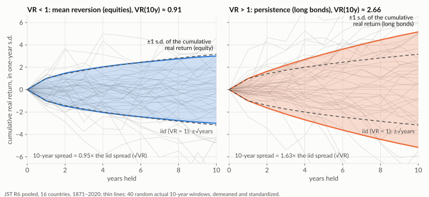

# Retirement SWR — Methodology

Research note for the **When can I retire?** tool (`/retirement`). It explains how the Monte Carlo engine works, where its return assumptions come from, why its long-horizon safe withdrawal rate (SWR) is lower than the familiar US "4% rule", and the historical evidence for drawing returns independently each year (`RETURN_AUTOCORRELATION = 0`). Read it before "fixing" an SWR that seems too low.

It is written for readers who know personal finance but not necessarily the simulation and statistics behind the tool. Technical terms are kept and defined on first use; the most common ones are collected in [Key terms](#key-terms).

Code: engine [`src/utils/retirement/monteCarlo.ts`](../../src/utils/retirement/monteCarlo.ts), presets [`src/utils/retirement/presets.ts`](../../src/utils/retirement/presets.ts), historical validation [`analysis/retirement/jst_swr_bootstrap.py`](../../analysis/retirement/jst_swr_bootstrap.py). The [glide-path methodology](../glide-path/methodology.md) uses the same capital-market assumptions and JST data.

## Contents

- [Summary](#summary)
- [Key terms](#key-terms)
- [1. Model](#1-model)
- [2. Why the long-horizon SWR is low](#2-why-the-long-horizon-swr-is-low)
- [3. Validation against history](#3-validation-against-history)
- [4. Serial correlation: why returns stay iid](#4-serial-correlation-why-returns-stay-iid)
- [5. Guidance for future changes](#5-guidance-for-future-changes)
- [Corrections log](#corrections-log)
- [References](#references)

---

## Summary

- **The long-horizon SWR is low because the return assumption is modest, not because the risk model is harsh.** A 60/40 portfolio at 90% success sustains 3.86% over 30 years and 2.86% over 50 years.
- **The returns are mainstream, not conservative.** The presets come from PWL Capital and are corroborated by FP Canada's Projection Assumption Guidelines: 3.5% real compound for 60/40.
- **The US "4% rule" does not transfer.** It reflects US real returns of ~6% (5.5% compound), the luckiest equity century on record.
- **History confirms the engine.** Historical return sequences, calibrated to the same forward-looking averages, give 3.86% at 30 years versus the engine's 3.90%; the gap is ≤ 0.07pp at every horizon.
- **The lever is the return assumption.** Raising the 50-year SWR to the US-style ~3.7% would need ~5% real compound returns, close to US history. Not recommended.

---

## Key terms

| Term | Meaning here |
| --- | --- |
| **Safe withdrawal rate (SWR)** | The first-year withdrawal, as a % of the starting portfolio, that can then be held constant in real terms and still last the whole horizon on a chosen share of simulated paths (the **success rate**, e.g. 90%). |
| **Real return** | Return after inflation. All amounts are real (today's) dollars. |
| **Geometric (compound) vs arithmetic (average) return** | The geometric return is the rate a balance actually compounds at; the arithmetic return is the simple average of yearly returns. For a volatile asset the arithmetic mean is higher by roughly σ²/2 (the _volatility drag_). Planning assumptions are quoted geometric; a Monte Carlo must draw from the arithmetic mean to reproduce them (§1.2). |
| **Monte Carlo** | Simulating thousands of possible market paths and counting how often the plan succeeds. |
| **iid** | Independent and identically distributed: each year's return is a fresh draw that does not depend on earlier years. |
| **Sequencing** | The order in which good and bad years arrive. For a retiree it matters because early losses are locked in by withdrawals (_sequence-of-returns risk_). |
| **Overlapping windows** | Running a retirement from every historical start year (1871, 1872, …), as Bengen's 4% rule did. |
| **Block bootstrap** | Simulating from history by stitching together runs (blocks) of consecutive historical years, so multi-year patterns survive. The _stationary_ version draws random block lengths with a set mean (here 10 years). |
| **Affine rescaling** | Shifting and stretching a historical return series to a target mean and volatility (`a + b·r`). It changes the level but keeps the sequencing pattern and the stock/bond correlation. |
| **Variance ratio, VR(q)** | Variance of q-year cumulative returns ÷ (q × variance of one-year returns). It is 1 for iid returns, below 1 under **mean reversion** and above 1 under **persistence** (§4). |
| **AR(1), φ** | A first-order autoregression: each year's return deviation is φ × last year's plus fresh noise. φ < 0 is mean reversion and φ > 0 persistence. |
| **JST** | The Jordà–Schularick–Taylor Macrohistory database (R6): annual returns for 16 countries with both stock and bond series, 1871–2020. |

---

## 1. Model

**In brief.** A two-phase simulation in real dollars. Savings grow to a candidate retirement age, then the portfolio pays the income gap each year under random returns. The tool reports the earliest age at which the plan succeeds often enough. A fixed random seed means identical inputs give identical output.

### 1.1 Phases

- **Accumulation** (`accumulationBalances`) is deterministic for the headline. Savings grow at the accumulation phase's real **geometric** return plus annual contributions, which gives the median-path balance. A separate stochastic pass (`retirementAgeRange`) simulates market luck during the saving years and reports the 25th–75th percentile range of the earliest feasible retirement age.
- **Drawdown** (`simulate`) is stochastic. From the balance at a candidate retirement age, each year:
  - draws a real return;
  - withdraws the income gap mid-year, so the withdrawal earns half a year's return. The gap is the target minus the guaranteed income started by that age (`guaranteedAtAge`), so it is the **full** target during a pre-pension bridge;
  - stops if the portfolio is depleted.
- **Spending guardrail** (`GUARDRAIL_TRIGGER = 1.2`). When spending flexibility is above 0, spending stays at the target until a weak sequence lifts the current withdrawal rate 20% above the rate at retirement; spending then drops to the floor (the target less the flexibility %). This is a simplified Guyton–Klinger rule: one binary cut, downside only, re-evaluated each year. At 0% flexibility it reduces to the fixed real withdrawal that the SWR tables below assume.

- **Guaranteed income** (`guaranteedAtAge`): three streams in real dollars, each from its own start age.
  - **CPP**, entered as the amount at 65 and adjusted for the start age (60–70): −0.6% per month before 65 (−36% at 60), +0.7% per month after (+42% at 70).
  - **OAS**, entered at 65 and deferrable to 70 at +0.6% per month (+36%); it rises 10% from age 75. The clawback on high incomes is not modelled.
  - **Workplace (DB) pension**, as a % of income or a dollar amount, from its own start age.
  - The income summary groups retirement years into phases of equal guaranteed income (`incomePhases`). Guaranteed income that starts while still working is saved. Inputs saved before CPP/OAS had their own fields load with CPP/OAS at 0, keeping the old single pension.

### 1.2 Returns

The presets are **nominal geometric** returns with volatilities (PWL Capital, inflation 2.1%, cross-checked against FP Canada's 2026 guidelines). Monte Carlo draws need **arithmetic** means, so each phase's preset is converted with the exact lognormal relation

```
(1+A)² = [ (1+G)² + √((1+G)⁴ + 4(1+G)²σ²) ] / 2
```

then deflated to real (`(1+A)/(1+π) − 1`, volatility `σ/(1+π)`). Each year's return is drawn from a normal distribution around that mean, independently of earlier years (`RETURN_AUTOCORRELATION = 0`, §4). Simulated compound growth therefore matches the preset's stated rate.

| Mix | Nominal geometric (input) | Volatility | Real geometric | Real arithmetic (MC mean) |
| --- | --- | --- | --- | --- |
| 100/0 | 6.87% | 12.57% | 4.67% | 5.38% |
| 80/20 | 6.29% | 10.62% | 4.10% | 4.62% |
| **60/40 (retirement default)** | **5.67%** | **8.79%** | **3.50%** | **3.85%** |
| 40/60 | 5.01% | 7.17% | 2.85% | 3.09% |

Custom returns are treated the same way (as nominal compound rates), with volatility taken from the calibrated `investmentAnnualVolPct` curve. Path counts:

- 1,000 for the headline feasibility and bands (~±1pp Monte Carlo noise on a 90% success rate);
- 300 sims × 800 paths for the age-range pass;
- 4,000 per technical-note table cell.

### 1.3 Outputs

- **Feasibility** (`computeRetirement`): the earliest age whose drawdown simulation meets the user's target success rate (e.g. 90%). The confidence covers drawdown market risk only; the headline savings come from the deterministic accumulation path, and saving-years luck shows up in the age range. The app says so under the headline.
- **Money left** (median of the drawdown bands at the planning age, today's dollars). The engine also reports `cutRate` (share of simulations with at least one guardrail cut); the app doesn't display it.
- The search runs in a Web Worker (`src/workers/retirementWorker.ts`, ~200 ms per input change on a desktop).
- **Reference SWR** (`safeWithdrawalRate`): the pure-portfolio SWR for a given return, volatility and horizon, independent of the user's savings and pension. The app doesn't display it (or any year-1 withdrawal rate); it stays in the engine for the reference tables below. It excludes CPP/OAS/pensions.

---

## 2. Why the long-horizon SWR is low

**In brief.** The SWR is driven mostly by the assumed real return. At 3.5% real compound for 60/40, a portfolio grows little while it is being drawn down, so every extra decade of retirement lowers the sustainable rate.

SWR at 90% success for 60/40, by assumed real **compound** return (current preset in bold):

| Real compound return | 20y       | 30y       | 40y       | 50y       |
| -------------------- | --------- | --------- | --------- | --------- |
| **3.5% (preset)**    | **5.28%** | **3.86%** | **3.22%** | **2.86%** |
| 4.0%                 | 5.53%     | 4.12%     | 3.50%     | 3.15%     |
| 4.5%                 | 5.79%     | 4.39%     | 3.80%     | 3.46%     |
| 5.0%                 | 6.05%     | 4.68%     | 4.11%     | 3.78%     |

- A typical retirement (retire at 60–65, plan to 95: a 30–35 year horizon) supports ~3.5–3.9%. Rates below 3% appear only at 45–50 year horizons (retiring at 45–50), where caution is appropriate.
- Each +0.5pp of real return adds ~0.3pp to the 50-year SWR. Matching the US-style ~3.7% at 50 years needs ~5% real compound, well above the 3.5% anchor.

---

## 3. Validation against history

**In brief.** Is drawing independent normal returns too optimistic or too pessimistic compared with how markets actually behaved? To check, the same withdrawal plan is run on real historical sequences, both at their raw historical return levels and rescaled to the app's forward-looking averages. At matched averages, history and the engine agree to within 0.07pp.

[`analysis/retirement/jst_swr_bootstrap.py`](../../analysis/retirement/jst_swr_bootstrap.py) runs the comparison on the **JST R6** database (1871–2020; the 16 countries with both stock and bond returns, which excludes Canada and Ireland). It downloads the data to the gitignored `analysis/.data/` and reuses the glide-path bootstrap code (`analysis/shared/jst_history.py`).

### 3.1 Design

Each column of the results table answers one question by combining three choices:

- **Return levels (marginals):** historical, or forward (rescaled to the presets).
- **Sequencing:** none, or historical blocks.
- **Dataset:** `world` averages all countries each year, a diversified series. `pooled` keeps each country's own sequence, which is the risk a single-country investor faced.

|  | Historical levels | Forward levels (rescaled to the presets) |
| --- | --- | --- |
| **Overlapping windows / no sequencing** | §A USA, §B world, §D pooled | §H the app's iid engine |
| **Block sequencing** | block bootstrap: §C world, §E pooled | forward-block: §F world, §G pooled |

- **Overlapping windows** run a retirement from every historical start year. They keep history's sequencing within each window but have few independent windows.
- **Block bootstrap** resamples runs of consecutive years (stationary bootstrap, 10-year mean block length), keeping multi-year patterns while producing many paths. The [glide-path note's Figure 2](../glide-path/methodology.md#how-sequencing-differs-from-iid) shows one simulated path.
- **Forward-block** first affine-rescales each asset's history to the presets' real arithmetic anchors (equity 5.38% / 12.31%, bonds 1.56% / 5.27%), so only the sequencing is historical.

The **§G vs §H** pair is the key test. Both have the same average returns, and they differ only in whether years follow historical patterns or are independent.

Real 60/40 return statistics:

| Series                            | Mean  | Vol    | Compound |
| --------------------------------- | ----- | ------ | -------- |
| USA (149 years)                   | 6.19% | 12.10% | 5.47%    |
| World, equal-weight (150 years)   | 5.14% | 9.61%  | 4.69%    |
| Pooled single-country (2,212 obs) | 5.04% | 15.44% | 3.79%    |
| World, forward-rescaled           | 3.85% | 8.39%  | 3.51%    |
| Pooled, forward-rescaled          | 3.85% | 8.26%  | 3.52%    |
| App preset, iid                   | 3.85% | 8.61%  | 3.50%    |

### 3.2 Results

SWR at 90% success, 60/40, 20,000 paths:

| Horizon | §A USA | §B World | §C World block | §D Pooled | §E Pooled block | §F World fwd-block | §G Pooled fwd-block | §H App iid |
| --- | --- | --- | --- | --- | --- | --- | --- | --- |
| 20y | 5.39% | 4.95% | 5.00% | 3.41% | 3.91% | 4.86% | 5.26% | 5.26% |
| 25y | 4.85% | 4.16% | 4.29% | 2.64% | 3.07% | 4.05% | 4.41% | 4.43% |
| 30y | 4.54% | 3.77% | 3.78% | 2.18% | 2.47% | 3.56% | 3.86% | 3.90% |
| 35y | 4.28% | 3.43% | 3.48% | 1.82% | 2.14% | 3.23% | 3.44% | 3.51% |
| 40y | 4.08% | 3.20% | 3.22% | 1.59% | 1.94% | 2.96% | 3.19% | 3.23% |
| 45y | 3.90% | 2.98% | 3.05% | 1.33% | 1.69% | 2.75% | 2.96% | 3.01% |
| 50y | 3.74% | 2.83% | 2.95% | 1.20% | 1.61% | 2.61% | 2.80% | 2.83% |

(§H is the Python replica of the engine; the web engine at 4,000 paths gives 3.86% at 30 years.)

### 3.3 Findings (30-year horizon)

1. **The engine matches forward-calibrated history (§G vs §H): 3.86% vs 3.90%.** The app is 0.00–0.07pp above pooled forward-block at every horizon: very slightly optimistic, not conservative. Two historical patterns roughly cancel here, equity mean reversion (which helps) and bond persistence (which hurts); see §4.
2. **A diversified, forward-looking Canadian retiree's range is 3.6–3.9%** (§F–§G). It is bracketed below by raw single-country history (§E, 2.47%) and above by US history (§A, 4.54%).
3. **Single-country history is far harsher** (§D 2.18%, §E 2.47%). It includes Germany 1914–1943, Japan in the 1940s and UK 1970s stagflation, when a single-country 60/40 retiree was wiped out. This sets a lower bound but does not describe a globally diversified investor. The damage comes from bad years clustering within a country-decade, so it survives block resampling.
4. **With 10-year blocks, block bootstrap tracks overlapping windows** on the world series (§C 3.78% vs §B 3.77%). An earlier study with 8-year blocks found the bootstrap fell below; that conclusion depended on block length.
5. **Lower forward returns lower the world floor** (§F 3.56% vs §B 3.77%): the historical world figure relied partly on its 4.69% compound return.
6. **Pooled sequencing beats world sequencing at the same levels** (§G 3.86% vs §F 3.56%). The world series has stronger bond persistence (VR(10y) ≈ 3.7 vs ≈ 2.7 pooled, arithmetic basis): sustained inflation epochs hit the bond leg and don't recover within a block. Pooled sequences also carry stronger within-country equity mean reversion.
7. **US history is exceptional** (§A 4.54%). It is close to the "4% rule", but partly by coincidence: Bengen's 4% is the worst case (100% success) over US history, while §A is a 90%-success figure. The ~0.8pp premium over the world average comes from higher US returns (5.47% vs 4.69% compound).

### 3.4 Caveats

These follow from the shared JST data ([glide-path methodology §6](../glide-path/methodology.md#6-caveats)):

- **Survivorship.** JST covers 16 developed markets that survived with usable data; the world floor and the within-country recoveries behind §G partly reflect that.
- **Tiny effective sample.** ~120 overlapping 30-year windows per series contain only 4–5 independent windows per country, heavily correlated across countries (the same wars, the same inflation waves). No column difference has a confidence interval.
- **Era dependence.** §G ≈ §H is a full-sample (1871–2020) statement. In the 1990–2020 inflation-targeting era bond persistence disappears (VR(10y) 0.58, within the iid range once cross-country co-movement is allowed for), so historical sequencing there would sit at or above iid. The two eras bracket iid.
- **Normal vs fat-tailed marginals.** The engine draws normal returns, while §G carries history's fat tails. The ≤ 0.07pp gap nets this against the sequencing effect, and the two cannot be separated.

---

## 4. Serial correlation: why returns stay iid

**In brief.** History has some year-to-year structure, but stocks and bonds have it in opposite directions. In a 60/40 portfolio the two roughly cancel, which is why the iid engine matches history (§3). A single autocorrelation setting cannot represent both, so the engine uses none.

The **variance ratio** measures this structure. Under iid returns, the spread of cumulative returns grows with the square root of the years held; VR(q) says how much faster or slower it actually grew:

- **Equity: mean reversion, VR(10y) ≈ 0.91.** Bad stretches are partly followed by recovery, so 10-year outcomes are slightly less dispersed than iid: 0.95× the iid spread (√0.91).
- **Long bonds: persistence, VR(10y) ≈ 2.7.** Bad real-return years cluster (inflation decades, rate cycles), so 10-year outcomes are about 1.6× as dispersed as iid.

<picture>
  <source media="(prefers-color-scheme: dark)" srcset="../glide-path/img/variance-ratio-dark.svg">
  
</picture>

_The coloured band is ±1 standard deviation of the cumulative real return after each number of years held, in units of the one-year standard deviation; the dashed band is the iid ±√years. Pooled JST history, arithmetic returns. From the [glide-path methodology](../glide-path/methodology.md#how-sequencing-differs-from-iid), which decomposes the bond persistence._

`RETURN_AUTOCORRELATION` is the engine's AR(1) coefficient φ on the annual return deviation. Over long horizons an AR(1) process has variance ratio **(1+φ)/(1−φ)**, which is the limit VR(q) approaches as q grows.

- **It was −0.2** (mean reversion). That gives a long-horizon VR of 0.8/1.2 ≈ 0.67, a cut of about a third in multi-year variance, which lifts the SWR. The value had been tuned to land the 30-year figure near Morningstar's.
- **It is now 0** (iid). The AR(1) machinery remains, so a separately justified view can be reintroduced by changing one constant.
- **Why not a small negative value?** Equity VR(10y) ≈ 0.91 corresponds to φ ≈ −0.05 (solving (1+φ)/(1−φ) = 0.91), but:
  - adding it barely moves the SWR;
  - bonds have the opposite sign (persistent, VR(10y) ≈ 2.7), which a single scalar AR(1) on the portfolio cannot represent;
  - the joint historical dynamics, tested directly in §3, put the engine within 0.07pp of history.

  The block bootstrap is the empirical answer; there is no need to approximate it parametrically.

---

## 5. Guidance for future changes

- **Don't chase the US 4% / 3.7% floor by inflating returns.** It would abandon the Canadian anchor; the low long-horizon SWR is the honest output.
- **Keep `RETURN_AUTOCORRELATION = 0`** (§4). Full-sample sequencing sits slightly below iid and 1990–2020 sequencing slightly above, so iid is bracketed from both sides. Use the historical bootstrap for research, not the parametric engine.
- **Keep presets geometric.** Any new return input should be treated as a nominal compound rate and converted for the Monte Carlo (`src/utils/returns.ts`); deterministic paths compound the geometric rate.
- **Re-run the validation** with `python3 -m analysis.retirement.jst_swr_bootstrap` (CONFIG block: allocation, `TARGET`, `BLOCK_YEARS`, `HORIZONS`). The §4 figure is regenerated with `python3 -m analysis.glide_path.doc_figures`.

---

## Corrections log

**November 2026 — return basis.** The PWL / FP-Canada presets are nominal **geometric** returns (FP Canada's guidelines say so and prescribe a conversion for Monte Carlo), but the engine had used them as the **arithmetic** mean of its normal draws. Every simulated mix therefore compounded ~σ²/2 below its stated rate (60/40 at 3.1% real instead of 3.5%). The engine now converts, and all figures above are regenerated.

|                                       | Before | After  |
| ------------------------------------- | ------ | ------ |
| Default plan: earliest retirement age | 60     | 59     |
| Default plan: headline SWR            | 4.26%  | 4.50%  |
| 60/40 SWR at 30 years                 | 3.68%  | 3.86%  |
| §G vs §H gap at 30 years              | 0.11pp | 0.04pp |

Two related corrections:

- **Preset labels.** The preset table had labelled the 4.7% / 3.5% figures "real arithmetic"; they are the real geometric rates.
- **The old §G–§H gap.** It was explained as "the PWL 60/40 return (3.50%) vs the linear per-asset blend (3.37%)". That difference was the geometric/arithmetic mix-up itself (the curve's concavity is the 60/40 diversification return), and it disappears once both are on the same basis.

**November 2026 — readability.** The note was restructured for a general finance audience (key terms, section lead-ins, a guide to the §A–§H design, the variance-ratio figure in §4). No figures changed.

---

## References

- PWL Capital — Financial Planning Assumptions (market-cap-weighted portfolio).
- FP Canada / Institut de planification financière — Projection Assumption Guidelines 2025/26.
- Jordà, Knoll, Kuvshinov, Schularick & Taylor (2019) — "The Rate of Return on Everything, 1870–2015", _QJE_ 134(3). Data: <https://www.macrohistory.net/database/>.
- Lo & MacKinlay (1988) — "Stock Market Prices Do Not Follow Random Walks", _Review of Financial Studies_ 1(1) (the variance-ratio test).
- Politis & Romano (1994) — "The Stationary Bootstrap", _JASA_ 89(428).
- Morningstar — "What's a Safe Retirement Withdrawal Rate?" (annual; Blanchett et al.).
- Kitces — Monte Carlo vs rolling historical returns and sequence-of-returns risk.
- Vanguard VCMM — valuation-conditioned forward returns (an example of in-simulation mean reversion; sophisticated but contested).
